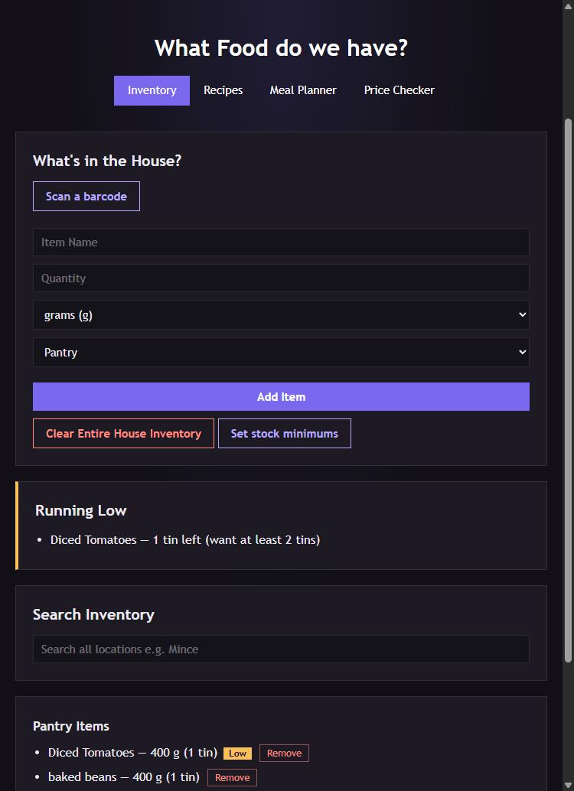
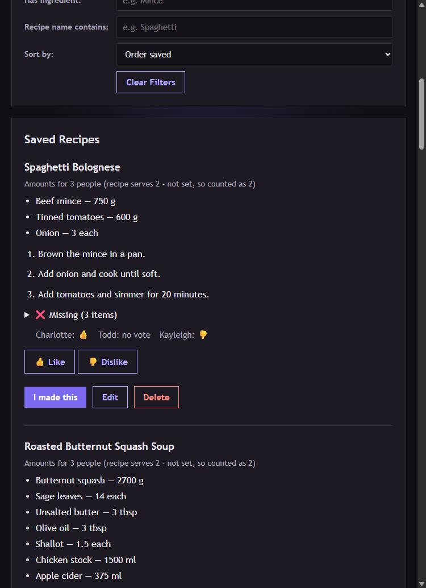
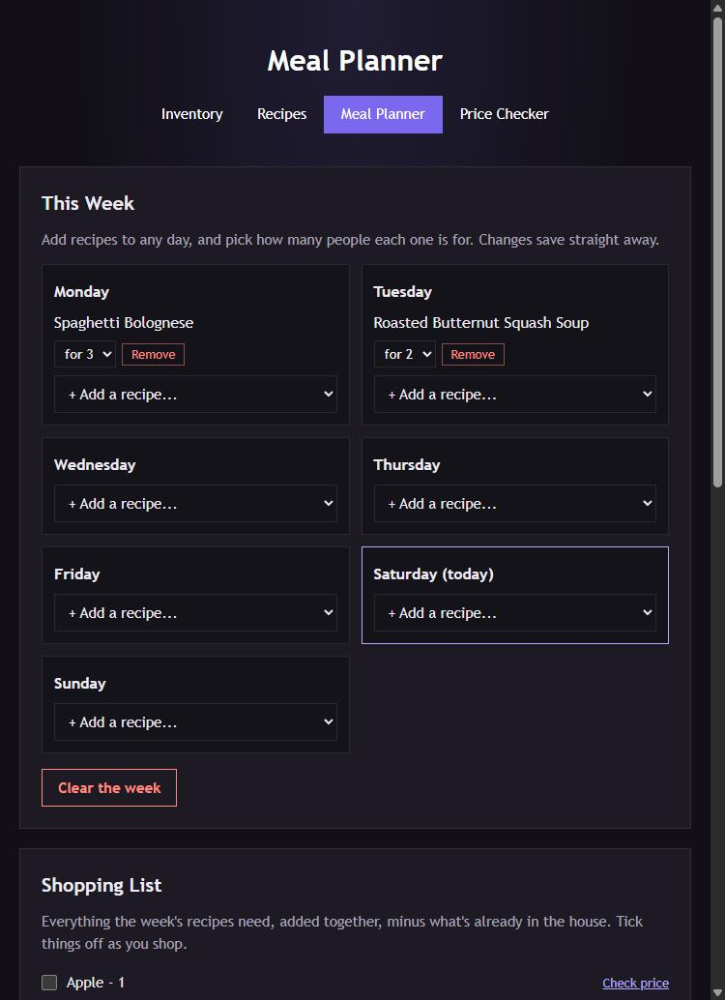
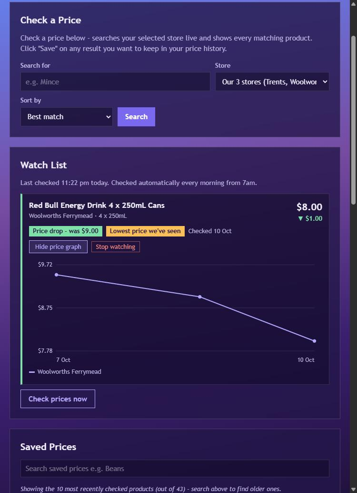

# Ingredients_And_Recipes

This is intended to help with a couple of issues:
1: I live with my boyfriend and also at my own house. We have two pantries, multiple freezers, and lots of food, especially in the freezer. We want to start buying in bulk as well as tracking what we have more accurately.

2: We also have different food tastes and allergies in the house, we want to make sure on days that we have my boyfriends daughter that recipes don't include eggs or gluten, but on days that we are just me and boyfriend we can have this food.

3: We also want to track preferences, so boyfriend and his daughter and I can track what we like, and start filtering by recipes we like.

4: We also want to start tracking and checking prices against the common supermarkets we go to (Pak n Save, Trents, Woolworths) to optimise our shopping

---

## What it looks like

| Inventory | Recipes |
|---|---|
|  |  |

| Meal Planner | Price Checker |
|---|---|
|  |  |

*(Screenshots are from a local test copy, so the prices shown are test data.)*

## What it does

**Inventory**
- Tracks what's in the pantry, fridge, inside freezer and chest freezer. Amounts are stored in grams / millilitres / each, so "2 kg" and "500 g" of the same thing add together.
- Tins are understood ("3 tins of chickpeas" = 1.2 kg), and tinned goods show how many tins that is.
- Scan a product's barcode with your phone camera to fill in the form. Products are looked up in your own products table first, then on [Open Food Facts](https://world.openfoodfacts.org), and the app remembers the name you used for each barcode.
- Remove single items, with an Undo button for a few seconds after any change.
- Optional stock minimums ("always want 2 tins of tomatoes") with a Running Low list.

**Recipes**
- Recipes with any number of ingredients, typed in, uploaded as a text file, or **imported from a link** to almost any recipe website.
- Each recipe is checked against everything in the house. Ingredient aliases (e.g. "ground beef" = "mince", US to NZ names) mean different wording still matches.
- "Cooking for 1 / 2 / 3 people" scales every recipe's amounts.
- Sort by "What can I make now?" (fewest missing ingredients first).
- Like/dislike votes per person, and filters.
- **I made this** takes the ingredients out of stock (fridge first), with an editable preview.

**Meal Planner**
- Pick recipes for each day of the week. It builds one combined shopping list, minus what's already in the house, with tick boxes and a "Copy list" button.

**Price Checker**
- Live price searches at Woolworths, PAK'nSAVE and Trents Wholesale (or all three at once), sortable by price or unit price.
- Saved price history grouped by product across stores, with a price graph. Each saved price keeps the supermarket's own product code; once that code is linked to a barcode, the same product from every supermarket shares one box.
- **Watch list**: star a product and the server re-checks its price every morning by itself. It shows "Price drop" and "Lowest price we've seen" badges.

**Behind the scenes**
- A simple first-name login, remembered per browser for a year.
- An activity log of who changed what, e.g. "Todd, Used (I made this), Mince, 500 g, Fridge".
- Backups of all the data (Azure's automatic database backups, plus a nightly backup on the garage).

## How it's built

- **No framework.** Plain HTML, CSS and JavaScript pages, and one Node.js server (`server.js`) using Node's built-in `http` module.
- **Data is stored in an Azure SQL Database** (Microsoft SQL Server in the cloud, on the free offer). There are 15 tables: people, stores, storage locations, a master list of ingredients (which also holds each stock minimum) and products (keyed by barcode), plus inventory, recipes, recipe ingredients, votes, aliases, prices, store products (each supermarket's product code linked to a barcode), the activity log, the meal plan and the watch list. See `database/create-tables.sql`, and [`docs/database-design.md`](docs/database-design.md) for the crow's foot and UML diagrams.
  - Only `people` has a number id. Every other table is keyed by its real-world identity, with composite keys where one column isn't enough (stock is keyed on storage area + name + unit, prices on store + product + time, products on their barcode, store products on chain + the supermarket's product code).
  - `server.js` still works with names ("Todd", "Woolworths Ferrymead"). `database.js` swaps them for keys inside the SQL.
  - Stock, recipe ingredients and products keep the name as typed, plus a link to the ingredient it counts as ("Diced Tomatoes" -> "Tinned Tomatoes"). The built-in aliases, tin sizes and suggestion names live in the `ingredients` and `ingredient_aliases` tables.
  - Each save is one T-SQL batch in a single transaction. The rows are sent as JSON and unpacked with `OPENJSON`, so a save is all-or-nothing.
  - Recipes save with `MERGE`, and their ingredients, votes and meal-plan entries are linked by foreign keys with `ON DELETE CASCADE`.
  - Prices and the activity log are insert-only, so the full history is kept line by line.
  - Saves still go through a one-at-a-time queue, so two people saving at once can't overwrite each other.
- **Price reports use a star schema.** Views in a separate `reporting` schema (`vw_fact_price`, `dim_store`, `dim_product`, `dim_date`, plus `vw_latest_price`) let a tool like Power BI chart prices by store, by chain and over time, through a read-only `pantry_reports` login. See `database/reporting-views.sql`.
- **The CSV files are retired.** The site needs `database-config.js` and stops with a clear message without it. The old CSV files are kept on the garage as an archive.
- **The store list and who can log in live in the database.** Adding a store (with its cookie value or store ID as `store_code`) or a person is one `INSERT` in SSMS, picked up within the hour.
- **The free database pauses itself when idle**, and its awake time counts against a monthly allowance. So the server never connects at start-up (it restarts every hour), closes idle connections after 30 seconds, and waits and retries while a paused database wakes up.
- **The supermarket scrapers use [Playwright](https://playwright.dev)**. They open a real Chromium browser, run the search on the store's own website, and read the prices out of the website's own data requests. Trents needs a real account login.
- **Recipe import** reads the hidden `schema.org/Recipe` data that recipe websites embed for Google. It then converts each ingredient line ("1 1/2 cups plain flour") into the app's name / quantity / unit format.

| File | What it is |
|---|---|
| `server.js` | The whole back end: reading and saving data, login, scrapers, recipe import, meal plan, watch list |
| `database.js` | Everything that talks to Azure SQL: which table each kind of data lives in, reads, transactional saves, retries |
| `database/create-tables.sql` | Creates all the tables in a new, empty database, with the starting people, stores and storage areas |
| `database/products-upgrade.sql` | One-off upgrade to phase 5: products by barcode, supermarket product codes, minimums on the ingredients table, real brands back on "Home Brand" prices |
| `database/archive/` | The one-off upgrade scripts that have already been run (phase 2, and phase 3's ingredients table), kept for the record |
| `database/seed-ingredients.sql` | The built-in ingredients and aliases, for a new database (run after `create-tables.sql`) |
| `database/reporting-views.sql` | The star schema views for price reports (safe to re-run) |
| `database/reports-login.sql` | Creates the read-only `pantry_reports` login for Power BI |
| `database/check-migration.sql` | Queries to check the data is all there |
| `docs/database-design.md` | The database design, with crow's foot and UML diagrams |
| `database-config.example.js` | What the real (gitignored) `database-config.js` looks like |
| `index.html` / `script.js` | Inventory page |
| `recipes.html` / `recipes.js` | Recipes page |
| `planner.html` / `planner.js` | Meal Planner page |
| `price-checker.html` / `price-checker.js` | Price Checker page |
| `login.html` / `login.js` / `auth.js` | Login page, and the check every page runs first |
| `undo-toast.js` | The "Removed Rice - Undo" message |
| `style.css` | All the styling |
| `backup-data.sh` | Nightly backup script for the server |

## Running it locally

You need [Node.js](https://nodejs.org) 18 or newer. The libraries aren't kept in git, so download them first:

```bash
npm ci
npx playwright install chromium
```

Then create the files that are deliberately **not** in the repo (they're in `.gitignore`):

**1. `credentials.js`** holds the Trents Wholesale login. It's only needed for Trents searches, but the server expects the file to exist:

```js
// NEVER commit this file - it's in .gitignore.
module.exports = {
    TRENTS_USERNAME: 'your-trents-login@example.com',
    TRENTS_PASSWORD: 'your-trents-password'
};
```

**2. `database-config.js`** says which database to use (copy `database-config.example.js`). Don't point your own computer at the live `pantry` database, or your testing changes the real household data. Instead:

1. In the Azure portal, create a second free database, e.g. `pantry_dev`, on the same server (the free offer allows several).
2. In SSMS (admin login, `pantry_dev`), run `database/create-tables.sql`, then `database/seed-ingredients.sql`, and create a `pantry_app` user there too.
3. Set `database: 'pantry_dev'` in your local `database-config.js`. Your computer's IP address has to be allowed in the server's firewall.

`server.js` creates `sessions.json` and `watch_check_status.json` itself the first time they're needed.

**3. `dev-server.js`** is a small local-only launcher. On the real server a web server sits in front of `server.js`: it serves the pages and passes anything starting with `/recipes/` through to `server.js` (port 3000) with that prefix removed. `dev-server.js` does the same job on port 8080 and starts `server.js` for you:

```bash
npm run dev
```

Then open <http://localhost:8080>. The login is a household member's first name as both the username and password (the names in the `people` table).

## How it runs at home

The live copy runs on a small Linux server in the garage, at `/opt/Ingredients_And_Recipes`, set up with systemd. Its data lives in Azure SQL:

- **The database** is `pantry` on the Azure SQL server `charlotte-inventory2.database.windows.net` (Australia East, free offer, auto-pauses when idle).
  - The site connects as `pantry_app`, a login that can only read and change data.
  - The admin login is only used in SSMS, for changing tables.
  - The connection details are in `database-config.js` on the garage only (gitignored, `chmod 600`).
- **The Azure firewall** only lets in the garage's internet address (and the PC used for SSMS). If the home internet address changes, the site's log says Azure blocked the IP. Add the new address under the SQL server's *Security → Networking* in the Azure portal.

- **`ingredients-recipes.service`** runs `server.js`. It runs under `xvfb-run`, which gives the scrapers' browser a virtual screen. A web server in front of it serves the pages and proxies `/recipes/` to it.
- **Libraries:** `node_modules` isn't in git. After an update that changes `package.json` / `package-lock.json`, run `npm ci --omit=dev` in `/opt/Ingredients_And_Recipes` on the garage, then restart the service.
- **`ingredients-recipes-update.timer`** deploys every hour. It fetches from GitHub, runs `git reset --hard origin/main` and `git clean -fd`, then restarts the service. Because the data files are gitignored, a deploy never touches them. The restart also re-reads the store list and people from the database.
- **`pantry-backup.timer`** runs `backup-data.sh` every night at 3am. Since the move to Azure SQL, the database itself is backed up automatically by Azure. This script still backs up `sessions.json` (who's logged in) and the old CSV files, but it doesn't back up the database. It zips every data file into `/opt/pantry-backups/pantry-YYYY-MM-DD.tar.gz` and keeps 30 days. Restore steps are at the top of the script.
- **The watch list's morning price check** runs inside `server.js` itself, from 7am NZ time. It needs no extra timer.

### Moving the garage from CSV files to the database (one-off)

1. In SSMS (admin login, `pantry` database), run `database/create-tables.sql`.
2. On the garage, stop the hourly update: `systemctl stop ingredients-recipes-update.timer`.
3. Copy the CSVs somewhere safe: `mkdir -p /root/csv-backup && cp /opt/Ingredients_And_Recipes/*.csv /root/csv-backup/`.
4. Create `/opt/Ingredients_And_Recipes/database-config.js` from `database-config.example.js` with the `pantry_app` password, then `chmod 600` it.
5. `systemctl stop ingredients-recipes`, then from the project folder run `node database/migrate-csv-to-database.js` (since removed from the repo - it's in the git history). It copied every CSV in one transaction and printed each file's row count next to its table's row count.
6. `systemctl start ingredients-recipes && systemctl start ingredients-recipes-update.timer`.
7. In SSMS, run `database/check-migration.sql` to see the data.

(Done on 11 October 2026. Since phase 2 the CSV fallback is gone, so deleting `database-config.js` no longer switches back to the CSV files.)

### Upgrading the live database to phase 2 (one-off)

The website code and the tables have to change together, so the site is stopped for a few minutes.

1. In SSMS, take a backup copy first: right-click the `pantry` database → **Tasks → Export Data-tier Application**, and save the `.bacpac` file on your PC.
2. On the garage: `systemctl stop ingredients-recipes-update.timer && systemctl stop ingredients-recipes`.
3. In SSMS (admin login, `pantry` database), open and run `database/archive/phase2-upgrade.sql`. It runs as one transaction: if anything fails, nothing changes. It finishes by listing every table's row count.
4. Push the phase 2 code from your PC, then run update-pantry on the garage (this starts the site again on the new code).
5. `systemctl start ingredients-recipes-update.timer`.
6. In SSMS, run `database/check-migration.sql`, and try the site.

(Done on 12 October 2026.)

### Upgrading the live database to phase 3: the ingredients table (one-off)

Same pattern as phase 2 - the tables and the code change together.

1. In SSMS, take a backup copy: right-click `pantry` -> **Tasks -> Export Data-tier Application**.
2. On the garage: `systemctl stop ingredients-recipes-update.timer && systemctl stop ingredients-recipes`.
3. In SSMS, right-click **pantry -> New Query** (the yellow bar must say `pantry`), open `database/archive/ingredients-upgrade.sql`, paste it into that window and run it. It's one transaction - if anything fails, nothing changes. It ends with the row counts and a list of every name you use and the ingredient it was linked to.
4. Push the phase 3 code from your PC, then run update-pantry on the garage.
5. `systemctl start ingredients-recipes-update.timer`.
6. In SSMS, run `database/check-migration.sql`, and try the site.

(Done on 12 October 2026: 483 ingredients, 622 aliases, every stock row and recipe ingredient linked.)

### Price reports: the star schema views (phase 4)

Views only - the website keeps running and nothing changes in the tables.

1. In SSMS, right-click **pantry -> New Query** (the yellow bar must say `pantry`), paste in `database/reporting-views.sql` and run it. It ends with a row count for each view.
2. Open `database/reports-login.sql`, put a new strong password in place of the placeholder, and run it the same way. Keep the password in your password manager.
3. Connect Power BI Desktop: **Get data -> Azure SQL database**, server `charlotte-inventory2.database.windows.net`, database `pantry`, **Import**, then **Database** credentials `pantry_reports`. Load the five `reporting` views, join `vw_fact_price` to the three dimensions on `full_date`, `store_name` and `product_name`, and mark `dim_date` as the date table. Your PC's IP address has to be allowed in the Azure firewall.

Import mode only reads the database when you press Refresh, so reports barely touch the free monthly allowance. `docs/database-design.md` has the star diagram.

### Upgrading the live database to phase 5: products by barcode (one-off)

Same pattern as phases 2 and 3 - the tables and the code change together, so the site is stopped for a few minutes.

1. In SSMS, take a backup copy: right-click `pantry` -> **Tasks -> Export Data-tier Application**.
2. On the garage: `systemctl stop ingredients-recipes-update.timer && systemctl stop ingredients-recipes`.
3. In SSMS, right-click **pantry -> New Query** (the yellow bar must say `pantry`), paste in `database/products-upgrade.sql` and run it. It's one transaction - if anything fails, nothing changes. It ends with the row counts and a few of the renamed prices.
4. Re-run `database/reporting-views.sql` the same way (its home brand flag now looks for Pams and Woolworths).
5. Push the phase 5 code from your PC, then run update-pantry on the garage.
6. `systemctl start ingredients-recipes-update.timer`.
7. In SSMS, run `database/check-migration.sql`, and try the site: scan something, save a price, check Running Low.
