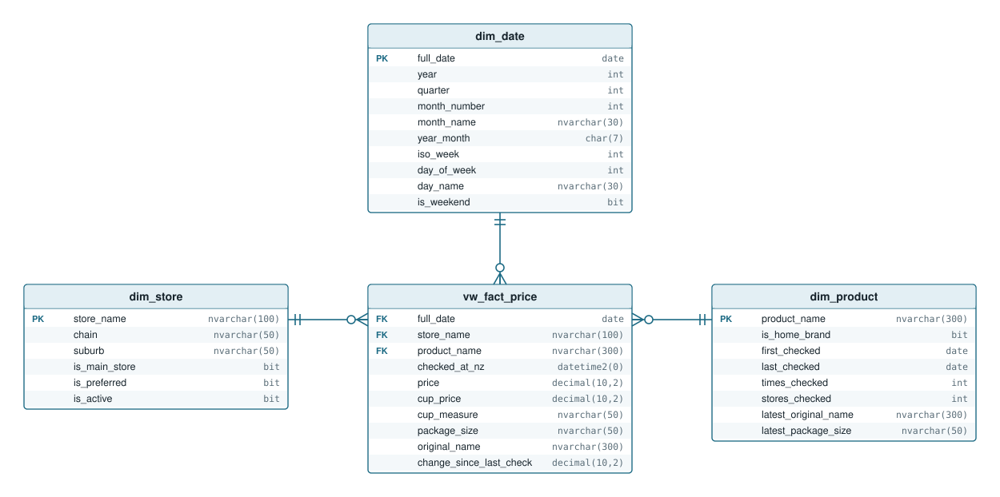
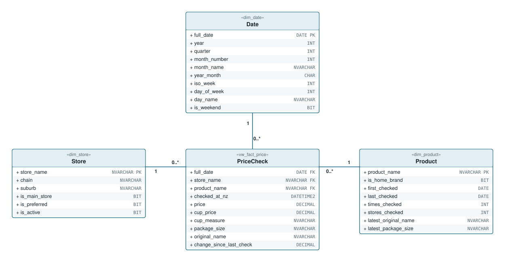
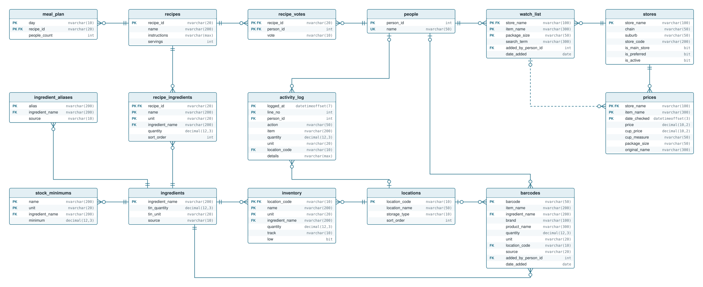
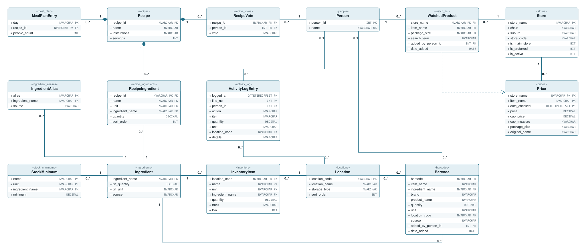
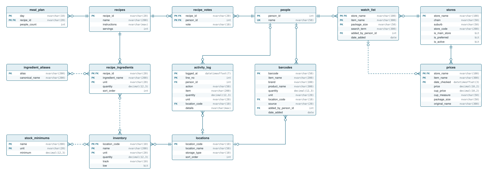
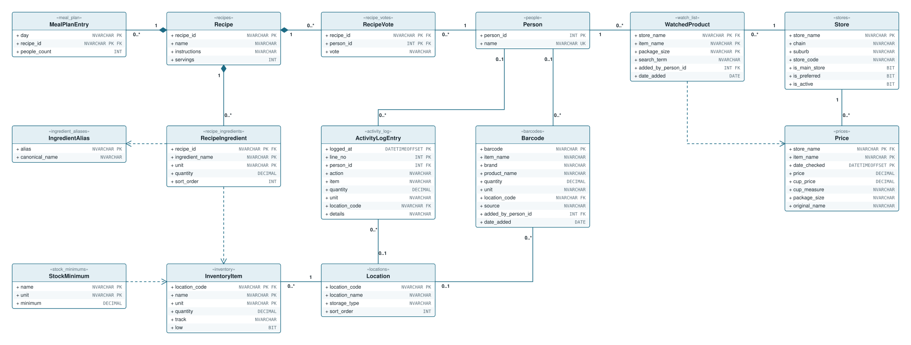
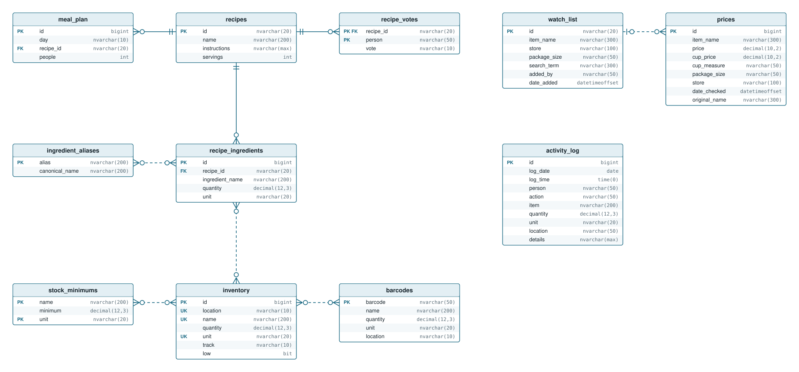
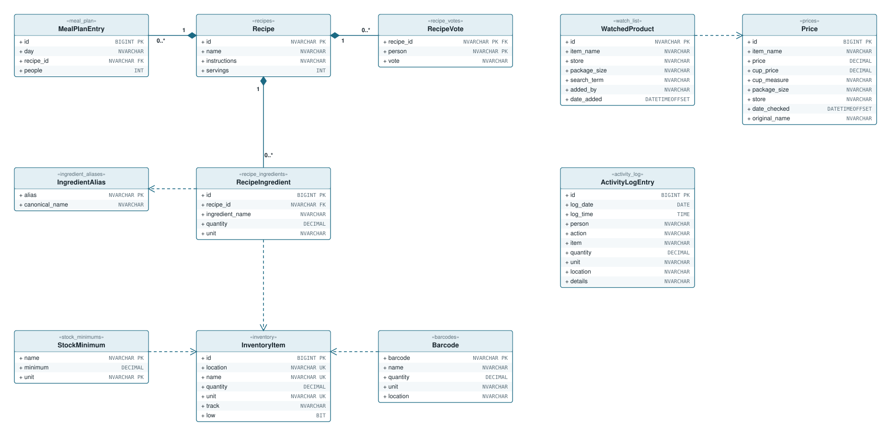

# Database design

The household data lives in the Azure SQL database `pantry` on `charlotte-inventory2.database.windows.net`. This page documents each version of the design, each as a crow's foot entity-relationship diagram and a UML class diagram:

- **Phase 4** - star schema views for price reports (made by [`database/reporting-views.sql`](../database/reporting-views.sql))
- **Phase 3** - the ingredients table, live since 12 October 2026 (made by [`database/ingredients-upgrade.sql`](../database/ingredients-upgrade.sql))
- **Phase 2** - people, stores and locations, natural and composite keys (made by [`database/phase2-upgrade.sql`](../database/phase2-upgrade.sql))
- **Phase 1** - the tables first moved off the CSV files

The table definitions for the newest design are in [`database/create-tables.sql`](../database/create-tables.sql). The diagrams are drawn by hand into the SVG files in [`docs/diagrams`](diagrams).

## Reading the UML diagrams

**Each box is one table**

The small name in angle brackets at the top, like <<inventory>>, is the real SQL table. The bigger name under it is a friendly name for one row of that table. Each line below is one column, with its SQL type and PK (part of the primary key), FK (points at another table) or UK (unique). The + at the start of each line is standard UML decoration and can be ignored.

**Filled diamond: "belongs to"**

The diamond sits on the owner. Recipe ingredients belong to their recipe, so deleting a recipe deletes its ingredients too (ON DELETE CASCADE). Used for recipe ingredients, votes and meal plan entries.

**Plain line: "points at"**

One table refers to another with a foreign key, and the database refuses a row that points at something missing. Nothing is deleted automatically.

**Numbers at the ends: "how many"**

Read across the line, using the number at the far end. Store 1 to Price 0..* means one store has any number of prices, and each price is at exactly 1 store. 1 = exactly one. 0..1 = none or one (optional, e.g. a log line with nobody logged in). 0..* = any number, including none.

**Dashed arrow: "looked up by name"**

No foreign key - the website code finds the matching row by comparing names, and the arrow points at the table being looked up. After phase 3 only one is left: a watched product's price history.

## Phase 4: star schema for price reports

- Views only, in their own reporting schema - nothing is copied, so reports always see the latest prices. The website doesn't use them.
- vw_fact_price is the fact: one row per saved price, with its NZ date, store, product, prices, size, and change_since_last_check (the difference from that product's previous price at that store).
- dim_store, dim_product and dim_date are the dimensions to slice by: store and chain, product (home brand or not), and the NZ calendar (year, quarter, month, ISO week, weekday, weekend).
- Keys stay natural: store_name, product_name and the date itself.
- vw_latest_price is an extra view outside the star: the newest price for each product at each store, ranked so cheapest_rank = 1 is the cheapest store right now.
- A read-only login, pantry_reports, can see only the reporting views - it's the one to give Power BI.

### Connecting Power BI

1. In Power BI Desktop (free, Windows): Get data -> Azure SQL database.
2. Server: charlotte-inventory2.database.windows.net, Database: pantry, Data connectivity: Import.
3. Sign in with Database credentials: pantry_reports and its password.
4. Tick the five reporting views and Load.
5. In Model view, join vw_fact_price.full_date to dim_date.full_date, store_name to dim_store, product_name to dim_product (Power BI usually finds these itself), and mark dim_date as the date table.
6. Import mode only reads the database when you press Refresh, so it barely touches the free monthly allowance.

## Phase 3: the ingredients table

- Adds the ingredients table: one row per ingredient, keyed by its name, with a tin size for things that come in tins.
- Stock, recipe ingredients, minimums and barcodes keep the name exactly as typed, plus an ingredient_name foreign key saying which ingredient it is ("Diced Tomatoes" -> "Tinned Tomatoes").
- The built-in aliases, tin sizes and suggestion names moved from ingredient-data.js into the database, marked source = built_in. Your own are source = yours, and win where both have the same alias.
- Links are worked out with the same matching the site always used - capitals, plurals, hyphens and apostrophes don't matter, and aliases are followed. A new name that matches nothing becomes a new ingredient.
- The dotted "matched by name" lines become real foreign keys. Only the watch list's price history is still matched by name.

### Every table and its columns

| Table | Primary key | Other columns | Why that key |
|---|---|---|---|
| `people` | `person_id (INT IDENTITY)` | name | The only number id. Every other table stores person_id, never the name, so renaming someone changes one row. |
| `stores` | `store_name` | chain, suburb, store_code, is_main_store, is_preferred, is_active | The name the scrapers, the store dropdown and the price history already use, e.g. Woolworths Ferrymead. |
| `locations` | `location_code` | location_name, storage_type, sort_order | Short fixed codes (pantry, fridge, freezer, chest), with the friendly name beside each. |
| `ingredients` | `ingredient_name` | tin_quantity, tin_unit, source | The master list - one row per ingredient (or anything else stocked). Everything that names an ingredient points here. |
| `ingredient_aliases` | `alias` | ingredient_name, source | Each alternative name ("Ground Beef") points at one ingredient ("Mince"). Built-in and your own, side by side. |
| `inventory` | `location_code + name + unit` | ingredient_name, quantity, track, low | One row per thing, per place, per unit. name is as typed; ingredient_name links it to the master list. |
| `recipes` | `recipe_id` | name, instructions, servings | The exact time (in milliseconds) the recipe was first saved, so nothing the pages already know changes. |
| `recipe_ingredients` | `recipe_id + name + unit` | ingredient_name, quantity, sort_order | One row per ingredient per unit, worded as the recipe words it. ingredient_name links it to the master list. |
| `recipe_votes` | `recipe_id + person_id` | vote | One vote per person per recipe. |
| `meal_plan` | `day + recipe_id` | people_count | Several recipes a day, each recipe once per day. |
| `prices` | `store_name + item_name + date_checked` | price, cup_price, cup_measure, package_size, original_name | One price per product, per store, per moment. Full history, never updated. |
| `activity_log` | `logged_at + line_no` | person_id, action, item, quantity, unit, location_code, details | The exact time of a change, plus line 1, 2, 3 for changes that log several rows at once (I made this). |
| `stock_minimums` | `name + unit` | ingredient_name, minimum | One minimum per item and unit, linked to its ingredient. |
| `barcodes` | `barcode` | item_name, ingredient_name, brand, product_name, quantity, unit, location_code, source, added_by_person_id, date_added | Your own barcode database: the number under the bars, your name for the product, its ingredient, brand and full name. |
| `watch_list` | `store_name + item_name + package_size` | search_term, added_by_person_id, date_added | The same rule the site already uses to stop the same product being starred twice. |

### Crow's foot diagram

Dotted lines are matched by name in the website code, not by a foreign key.

### UML class diagram

## Phase 2: people, stores and locations

- Added people, stores and locations. Number ids for people only; natural and composite keys everywhere else.
- The store list, the "Our N stores" search and who can log in come from the database. The CSV fallback was retired.

### Crow's foot diagram

### UML class diagram

## Phase 1: the first move off the CSV files

The tables as first moved off the CSV files on 11 October 2026. Each mirrored one CSV file. Only recipes were linked by foreign keys.

### Crow's foot diagram

### UML class diagram

