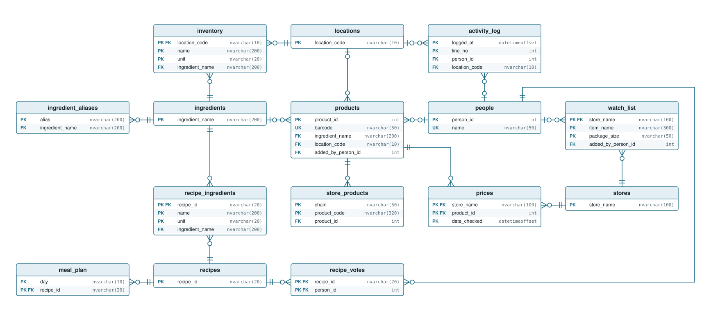
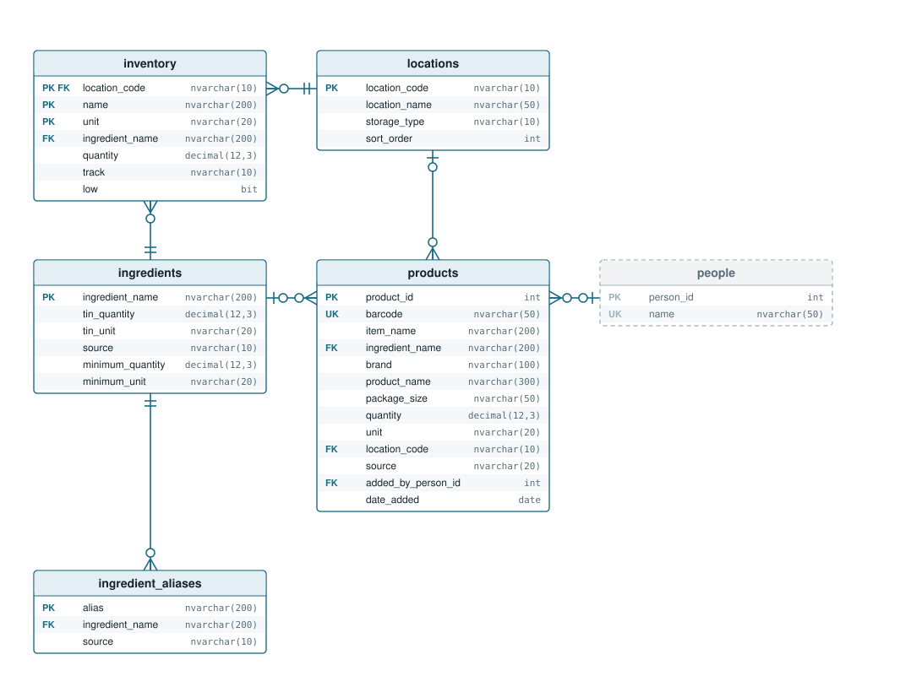
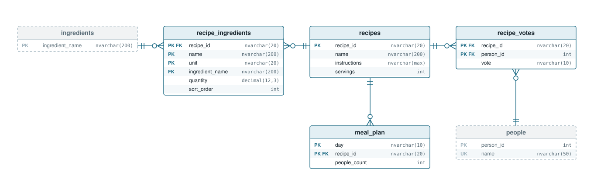
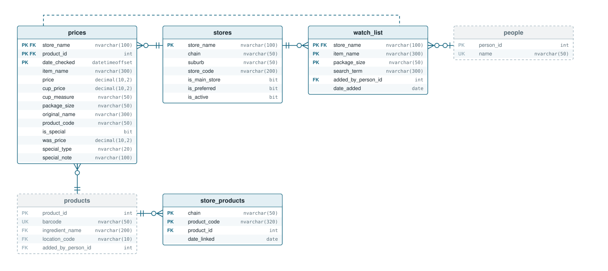
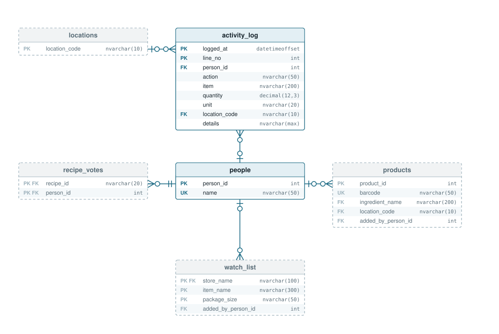
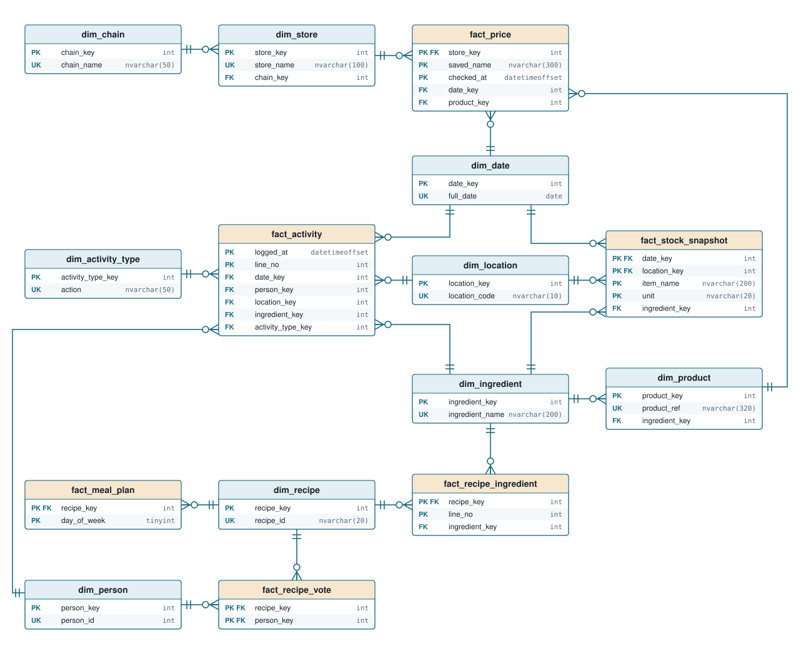
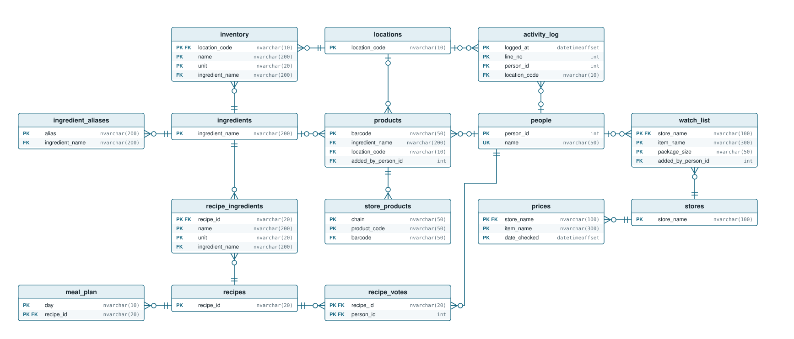
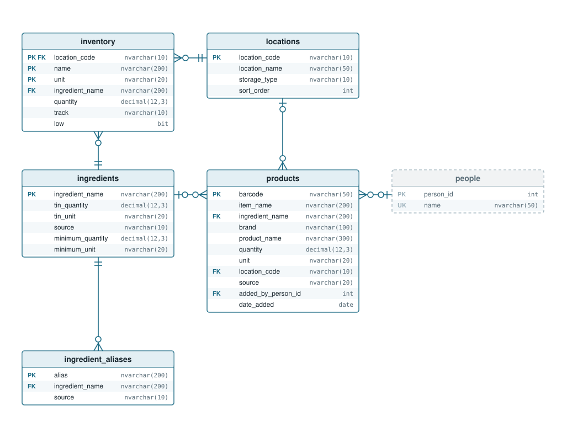
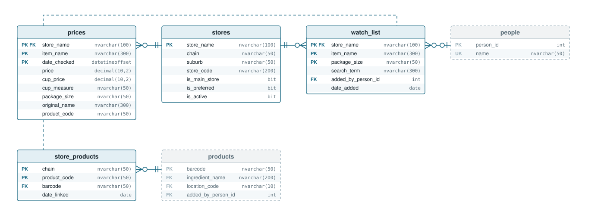
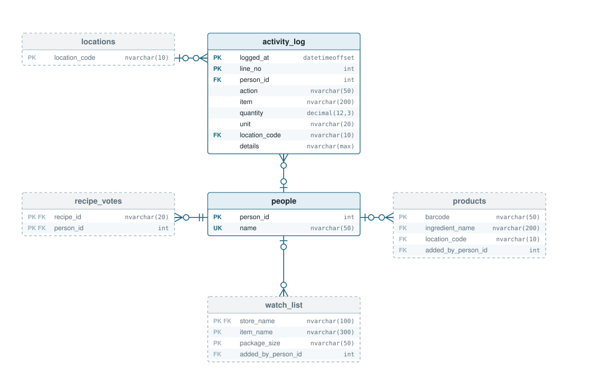

# Database design

The household data lives in the Azure SQL database `pantry` on `charlotte-inventory2.database.windows.net`. This page documents each version of the design, each as a crow's foot entity-relationship diagram and a UML class diagram:

- **Phase 7** - every price points at a product, and specials are recorded (made by [`database/product-ids-upgrade.sql`](../database/product-ids-upgrade.sql))
- **Phase 6** - the warehouse: a galaxy schema for reports, with real keys (made by [`database/warehouse.sql`](../database/warehouse.sql))
- **Phase 5** - products by barcode, supermarket product codes, minimums on the ingredients table (made by [`database/products-upgrade.sql`](../database/products-upgrade.sql))
- **Phase 4** - star schema views for price reports (made by [`database/reporting-views.sql`](../database/reporting-views.sql))
- **Phase 3** - the ingredients table, live since 12 October 2026 (made by [`database/archive/ingredients-upgrade.sql`](../database/archive/ingredients-upgrade.sql))
- **Phase 2** - people, stores and locations, natural and composite keys (made by [`database/archive/phase2-upgrade.sql`](../database/archive/phase2-upgrade.sql))
- **Phase 1** - the tables first moved off the CSV files

The table definitions for the newest design are in [`database/create-tables.sql`](../database/create-tables.sql). The diagrams are laid out by hand into the SVG files in [`docs/diagrams`](diagrams) - the website's tables as they are today are under Phase 7, and the reports warehouse under Phase 6.

## Reading the UML diagrams

**Each box is one table**

The small name in angle brackets at the top, like <<inventory>>, is the real SQL table. The bigger name under it is a friendly name for one row of that table. Each line below is one column, with its SQL type and PK (part of the primary key), FK (points at another table) or UK (unique). The + at the start of each line is standard UML decoration and can be ignored.

**Filled diamond: "belongs to"**

The diamond sits on the owner. Recipe ingredients belong to their recipe, so deleting a recipe deletes its ingredients too (ON DELETE CASCADE). Used for recipe ingredients, votes and meal plan entries.

**Plain line: "points at"**

One table refers to another with a foreign key, and the database refuses a row that points at something missing. Nothing is deleted automatically.

**Numbers at the ends: "how many"**

Read across the line, using the number at the far end. Store 1 to Price 0..* means one store has any number of prices, and each price is at exactly 1 store. 1 = exactly one. 0..1 = none or one (optional, e.g. a log line with nobody logged in). 0..* = any number, including none.

**Dashed arrow: "looked up by name"**

No foreign key - the website code finds the matching row by comparing names, and the arrow points at the table being looked up. After phase 3 only one is left: a watched product's price history.

## Phase 7: every price points at a product

- products gets a number key, product_id. The barcode is still on it - optional, and unique when it's there - because most products now come from price checks, and many never get a barcode (Trents, loose produce).
- prices gets product_id, a foreign key: every price belongs to a product. Its key becomes store + product + moment - one price per product, per store, per moment.
- store_products maps each chain's own product code to a product_id. Trents has no codes, so its saved name stands in ("name:Bulk Rice 10kg"); the same goes for prices saved before product codes existed.
- Saving a price finds its product by the store's chain + product code, or makes a new one. A barcode links products: dbo.usp_link_barcode links a barcode to a code, and if that shows two product rows are really the same thing, it merges them - moving the prices and codes across - so the product's prices from every supermarket end up together.
- Specials: prices gets is_special, was_price (the normal price), special_type (special, club, multibuy) and special_note ("SAVE $1.50", "Limit 4 Assorted"). price is always what you'd pay. Woolworths sends isSpecial / wasPrice / isClubPrice; PAK'nSAVE sends a list of promotions (before phase 7 its normal price was saved even when it was on special).
- The dotted line between prices and store_products is gone - it's a real foreign key through products now. The only link still made by the website code is a watched product finding its price history.
- Why a number key here, when everything else is keyed by its real-world identity: a product without a barcode has no natural key. This follows the same idea as a real price comparison site's model - one shared product identity that every price points at.

### The website's tables today

The whole design on one page, keys only - every primary key (PK), foreign key (FK) and unique key (UK), and every relationship between them:

The same tables split into the four things the site does, with every column. A faded, dashed table belongs to another area and is only there to show what it links to.

- A line ending in a bar and a circle (zero or one) is an optional link: the column can be empty, e.g. a log line with nobody logged in.
- A dotted line is matched in the website code, not by a foreign key.

**Stock** - what's in the house, the master list of ingredients, and products

**Recipes** - recipes, their ingredients, votes and the meal plan

**Prices** - stores, saved prices, the watch list, and supermarket product codes. Dotted line: a watched product finds its price history by store and name.

**People** - who can log in, the activity log, and everything that records who did it

## Phase 6: the warehouse (a galaxy schema)

- The website's tables (the dbo schema) stay as they are: normalised, so each fact is stored once and a change touches one row. That's the right shape for an app. Reports want a different shape, so the warehouse is a second copy of the data, in its own dw schema, laid out for reports.
- It's a galaxy (or constellation) schema: six fact tables share the same dimension tables. Two dimensions branch off another one - store -> chain and product -> ingredient - which is the snowflake part.
- Facts are things that happened, or were true on a day: a price was saved, stock was used, this was in the fridge on Tuesday. Dimensions are what you slice them by: when, where, who, what.
- Every dimension has a surrogate key (store_key, product_key...) - a plain number that never changes - plus its business key from the website (store_name, barcode...) as a unique key (UK). Facts point at dimensions only through those numbers.
- Each fact's primary key is its grain - what one row is - so it mirrors the website table it came from: a price is one store + saved name + moment. Values like saved_name and logged_at are degenerate dimensions: identifying values kept on the fact, with no table of their own.
- Key -1 is the Unknown row in a dimension, e.g. a log line with nobody logged in, or a log line whose item doesn't match an ingredient any more. So every foreign key always has a row to point at.
- dw.usp_load_warehouse fills it from the website's tables, in one transaction. Dimensions are upserted with MERGE, so keys never change; a row gone from the website stays with is_current = 0. Facts are reloaded, except fact_stock_snapshot, which adds today's copy of the stock list and keeps every earlier day - so stock levels build up a history.
- The website runs the load every morning after the watch list check. Run `EXEC dw.usp_load_warehouse;` in SSMS before refreshing Power BI if you want it up to the minute.

Fact tables have orange headers, dimension tables blue. The diagram shows the keys; every column is listed below.

### Which facts use which dimensions (the bus matrix)

| Fact | date | store / chain | product / ingredient | ingredient | location | person | activity type | recipe |
|---|---|---|---|---|---|---|---|---|
| `fact_price` | yes | yes | yes | (through product) | | | | |
| `fact_activity` | yes | | | yes | yes | yes | yes | |
| `fact_stock_snapshot` | yes | | | yes | yes | | | |
| `fact_recipe_ingredient` | | | | yes | | | | yes |
| `fact_recipe_vote` | | | | | | yes | | yes |
| `fact_meal_plan` | | | | | | | | yes |

The shared ("conformed") dimensions are what link the stars together: dim_ingredient joins prices, stock movements, stock levels and recipes, so a report can show, for one ingredient, what it costs, how fast it's used, how much is in the house and which recipes need it.

### Every warehouse table and its columns

| Table | Primary key | Other columns |
|---|---|---|
| `dim_date` | `date_key` (e.g. 20261020) | full_date (UK), year, quarter, month_number, month_name, year_month, iso_week, day_of_week (Mon = 1), day_name, is_weekend |
| `dim_person` | `person_key` | person_id (UK), name, is_current |
| `dim_location` | `location_key` | location_code (UK), location_name, storage_type, sort_order, is_current |
| `dim_chain` | `chain_key` | chain_name (UK) |
| `dim_store` | `store_key` | store_name (UK), chain_key (FK), suburb, is_main_store, is_preferred, is_active, is_current |
| `dim_ingredient` | `ingredient_key` | ingredient_name (UK), source, tin_quantity, tin_unit, minimum_quantity, minimum_unit, has_minimum, is_current |
| `dim_product` | `product_key` | product_id (UK, since phase 7), barcode, product_name, brand, package_size, ingredient_key (FK), is_home_brand, is_current |
| `dim_recipe` | `recipe_key` | recipe_id (UK), recipe_name, servings, is_current |
| `dim_activity_type` | `activity_type_key` | action (UK), category (stock in, stock out, stock change, running low, minimum, recipe, other), direction (+1, -1, 0) |
| `fact_price` | `store_key + product_key + checked_at` | date_key, saved_name, checked_at_nz, price, cup_price, cup_measure, package_size, original_name, product_code, is_special, was_price, special_type, special_note, change_since_last_check |
| `fact_activity` | `logged_at + line_no` | date_key, person_key, location_key, ingredient_key, activity_type_key, logged_at_nz, item_as_typed, quantity, unit, signed_quantity, details |
| `fact_stock_snapshot` | `date_key + location_key + item_name + unit` | ingredient_key, quantity, is_low |
| `fact_recipe_ingredient` | `recipe_key + line_no` | ingredient_key, name_as_written, quantity, unit |
| `fact_recipe_vote` | `recipe_key + person_key` | vote, vote_value (like = 1, dislike = -1) |
| `fact_meal_plan` | `recipe_key + day_of_week` | day_name, people_count |

### Power BI on the warehouse

1. Get data -> Azure SQL database, the same server and database, Import, Database credentials pantry_reports.
2. Tick the dw tables and Load. Power BI reads the foreign keys and makes the relationships itself: each is many-to-one (*:1) from the fact to the dimension, single direction.
3. Mark dw dim_date as the date table (date column: full_date).
4. dim_store -> dim_chain and dim_product -> dim_ingredient are the snowflake relationships - keep them; slicing prices by chain or ingredient goes through them.
5. Hide the key columns (the *_key ones) in report view - they're for joining, not for showing.

## Phase 5: products by barcode

- barcodes becomes products: one row per real product, keyed by its barcode. Your name for it and its ingredient are now optional, so a product a supermarket told us about can be saved before anyone has scanned it at home.
- Adds store_products: each supermarket chain's own code for a product (PAK'nSAVE "5001949-EA-000") linked to its barcode. It's per chain, because every branch uses the same code. PAK'nSAVE and New World share codes.
- prices gains product_code, so every saved price knows exactly which supermarket product it was. Once that code is linked to a barcode, every price with it - old ones too - knows its barcode, and Saved Prices puts the same product from every supermarket in one box.
- stock_minimums is gone: a minimum is a fact about an ingredient ("always want 2 tins of tomatoes"), so it's two columns on ingredients, minimum_quantity and minimum_unit. One fewer table, and no more repeating the name.
- "Home Brand" is gone: prices keep their real brand (Pams, Woolworths Essentials). The upgrade put the real brand back on the 123 prices saved as "Home Brand ...", from the supermarket's own name in original_name. Pams and Woolworths own-brand products never share a barcode, so comparing those is done by their ingredient instead.
- Still 15 tables: products replaces barcodes, store_products replaces stock_minimums.

### The website's tables in phase 5

Superseded by phase 7 above - kept to show how it got there.

The same tables split into the four things the site does, with every column. A faded, dashed table belongs to another area and is only there to show what it links to.

- A line ending in a bar and a circle (zero or one) is an optional link: the column can be empty, e.g. a log line with nobody logged in.
- A dotted line is matched in the website code, not by a foreign key.

**Stock** - what's in the house, the master list of ingredients, and products by barcode

**Recipes** - recipes, their ingredients, votes and the meal plan

**Prices** - stores, saved prices, the watch list, and supermarket product codes. Dotted lines: a price finds its product through its store's chain + product_code, and a watched product finds its price history by store and name.

**People** - who can log in, the activity log, and everything that records who did it

### What changed, table by table

| Table | Primary key | Columns | Why |
|---|---|---|---|
| `products` (was `barcodes`) | `barcode` | item_name, ingredient_name, brand, product_name, quantity, unit, location_code, source, added_by_person_id, date_added | The hub for anything with a barcode. item_name and ingredient_name can be empty until it's scanned at home. source can now also be supermarket. |
| `store_products` (new) | `chain + product_code` | barcode, date_linked | Links a supermarket's own product code to a barcode, so prices can be matched to the real product. |
| `prices` | `store_name + item_name + date_checked` | ... plus product_code | The supermarket's own code for the product. Blank for Trents and for prices saved before phase 5. |
| `ingredients` | `ingredient_name` | ... plus minimum_quantity, minimum_unit | The stock minimum, moved here from stock_minimums. Empty = no minimum. |
| `stock_minimums` | - | - | Dropped - now part of ingredients. |

### How a price gets linked to a barcode

1. A price check saves the supermarket's product code with the price, every time.
2. If the supermarket also sent the barcode (Woolworths' results can include it), the code is linked to that barcode in store_products, and the barcode is added to products if it's new.
3. PAK'nSAVE doesn't send barcodes with search results. Searching PAK'nSAVE with a barcode does return its product code, so that's the way to link those - not built yet.

## Phase 4: star schema for price reports

- Views only, in their own reporting schema - nothing is copied, so reports always see the latest prices. The website doesn't use them.
- vw_fact_price is the fact: one row per saved price, with its NZ date, store, product, prices, size, and change_since_last_check (the difference from that product's previous price at that store).
- dim_store, dim_product and dim_date are the dimensions to slice by: store and chain, product (home brand or not - since phase 5, a name starting with Pams or Woolworths), and the NZ calendar (year, quarter, month, ISO week, weekday, weekend).
- Keys stay natural: store_name, product_name and the date itself.
- vw_latest_price is an extra view outside the star: the newest price for each product at each store, ranked so cheapest_rank = 1 is the cheapest store right now.
- A read-only login, pantry_reports, can see only the reporting views - it's the one to give Power BI.

### Connecting Power BI

1. In Power BI Desktop (free, Windows): Get data -> Azure SQL database.
2. Server: charlotte-inventory2.database.windows.net, Database: pantry, Data connectivity: Import.
3. Sign in with Database credentials: pantry_reports and its password.
4. Tick the five reporting views and Load.
5. In Model view, join vw_fact_price.full_date to dim_date.full_date, store_name to dim_store, product_name to dim_product (Power BI usually finds these itself), and mark dim_date as the date table.
6. Import mode only reads the database when you press Refresh, so it barely touches the free monthly allowance.

## Phase 3: the ingredients table

- Adds the ingredients table: one row per ingredient, keyed by its name, with a tin size for things that come in tins.
- Stock, recipe ingredients, minimums and barcodes keep the name exactly as typed, plus an ingredient_name foreign key saying which ingredient it is ("Diced Tomatoes" -> "Tinned Tomatoes").
- The built-in aliases, tin sizes and suggestion names moved from ingredient-data.js into the database, marked source = built_in. Your own are source = yours, and win where both have the same alias.
- Links are worked out with the same matching the site always used - capitals, plurals, hyphens and apostrophes don't matter, and aliases are followed. A new name that matches nothing becomes a new ingredient.
- The dotted "matched by name" lines become real foreign keys. Only the watch list's price history is still matched by name.

### Every table and its columns

| Table | Primary key | Other columns | Why that key |
|---|---|---|---|
| `people` | `person_id (INT IDENTITY)` | name | The only number id. Every other table stores person_id, never the name, so renaming someone changes one row. |
| `stores` | `store_name` | chain, suburb, store_code, is_main_store, is_preferred, is_active | The name the scrapers, the store dropdown and the price history already use, e.g. Woolworths Ferrymead. |
| `locations` | `location_code` | location_name, storage_type, sort_order | Short fixed codes (pantry, fridge, freezer, chest), with the friendly name beside each. |
| `ingredients` | `ingredient_name` | tin_quantity, tin_unit, source | The master list - one row per ingredient (or anything else stocked). Everything that names an ingredient points here. |
| `ingredient_aliases` | `alias` | ingredient_name, source | Each alternative name ("Ground Beef") points at one ingredient ("Mince"). Built-in and your own, side by side. |
| `inventory` | `location_code + name + unit` | ingredient_name, quantity, track, low | One row per thing, per place, per unit. name is as typed; ingredient_name links it to the master list. |
| `recipes` | `recipe_id` | name, instructions, servings | The exact time (in milliseconds) the recipe was first saved, so nothing the pages already know changes. |
| `recipe_ingredients` | `recipe_id + name + unit` | ingredient_name, quantity, sort_order | One row per ingredient per unit, worded as the recipe words it. ingredient_name links it to the master list. |
| `recipe_votes` | `recipe_id + person_id` | vote | One vote per person per recipe. |
| `meal_plan` | `day + recipe_id` | people_count | Several recipes a day, each recipe once per day. |
| `prices` | `store_name + item_name + date_checked` | price, cup_price, cup_measure, package_size, original_name | One price per product, per store, per moment. Full history, never updated. |
| `activity_log` | `logged_at + line_no` | person_id, action, item, quantity, unit, location_code, details | The exact time of a change, plus line 1, 2, 3 for changes that log several rows at once (I made this). |
| `stock_minimums` | `name + unit` | ingredient_name, minimum | One minimum per item and unit, linked to its ingredient. |
| `barcodes` | `barcode` | item_name, ingredient_name, brand, product_name, quantity, unit, location_code, source, added_by_person_id, date_added | Your own barcode database: the number under the bars, your name for the product, its ingredient, brand and full name. |
| `watch_list` | `store_name + item_name + package_size` | search_term, added_by_person_id, date_added | The same rule the site already uses to stop the same product being starred twice. |

### Crow's foot diagram

Dotted lines are matched by name in the website code, not by a foreign key.

### UML class diagram

## Phase 2: people, stores and locations

- Added people, stores and locations. Number ids for people only; natural and composite keys everywhere else.
- The store list, the "Our N stores" search and who can log in come from the database. The CSV fallback was retired.

### Crow's foot diagram

### UML class diagram

## Phase 1: the first move off the CSV files

The tables as first moved off the CSV files on 11 October 2026. Each mirrored one CSV file. Only recipes were linked by foreign keys.

### Crow's foot diagram

### UML class diagram

