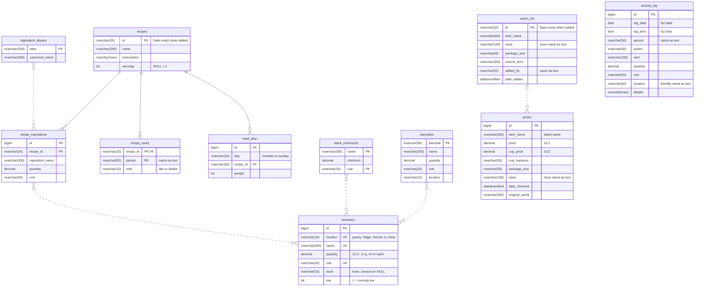
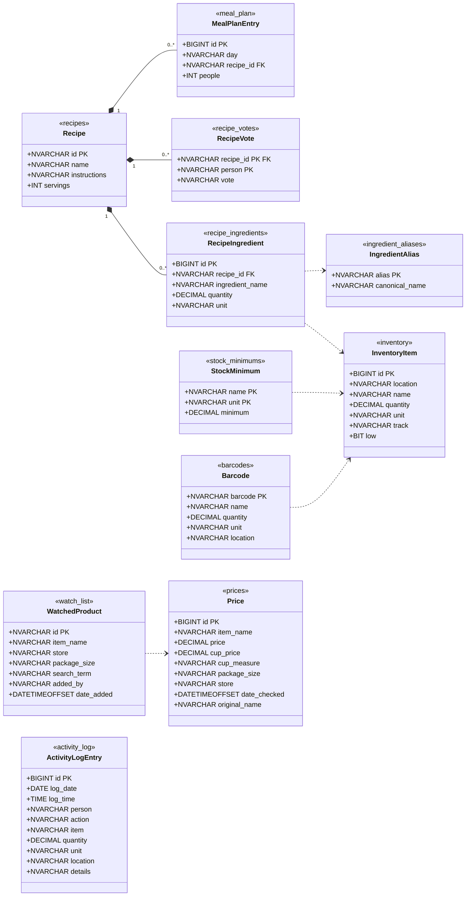
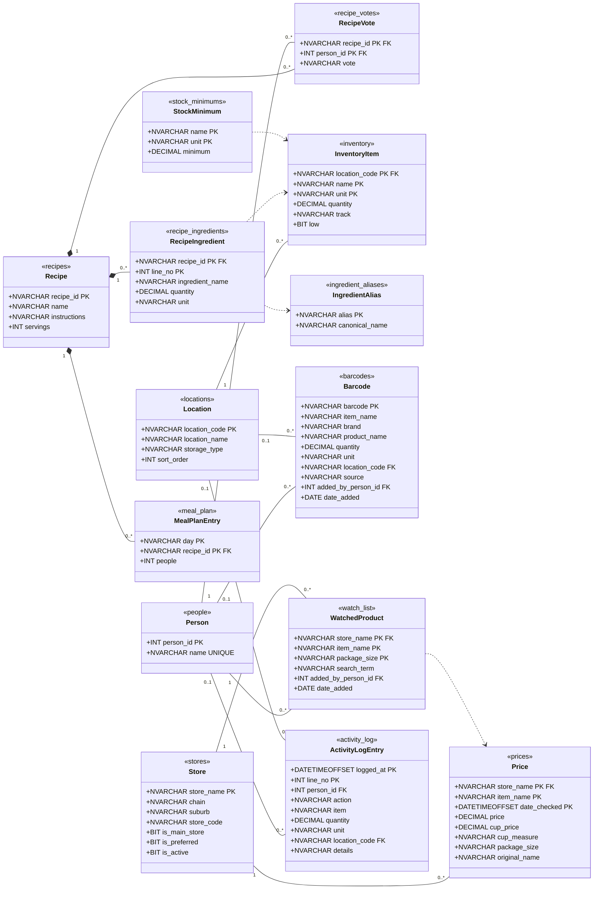

```mermaid
erDiagram
    people ||--o{ recipe_votes : ""
    people |o--o{ activity_log : ""
    people ||--o{ watch_list : ""
    people |o--o{ barcodes : ""
    stores ||--o{ prices : ""
    stores ||--o{ watch_list : ""
    locations ||--o{ inventory : ""
    locations |o--o{ barcodes : ""
    locations |o--o{ activity_log : ""
    recipes ||--o{ recipe_ingredients : ""
    recipes ||--o{ recipe_votes : ""
    recipes ||--o{ meal_plan : ""
    recipe_ingredients }o..o{ inventory : ""
    ingredient_aliases }o..o{ recipe_ingredients : ""
    stock_minimums }o..o{ inventory : ""
    watch_list |o..o{ prices : ""
    people {
        int person_id PK "the only number id"
        nvarchar(50) name UK "Charlotte, Todd, Kayleigh"
    }
    stores {
        nvarchar(100) store_name PK "e.g. Woolworths Ferrymead"
        nvarchar(50) chain "Woolworths, PAKnSAVE or Trents"
        nvarchar(50) suburb "e.g. Ferrymead"
        nvarchar(200) store_code "cookie or store ID the scraper uses"
        bit is_main_store "in the Our 3 stores search"
        bit is_preferred "shown first, used for best price"
        bit is_active "still searched"
    }
    locations {
        nvarchar(10) location_code PK "pantry, fridge, freezer, chest"
        nvarchar(50) location_name "e.g. Freezer (Inside)"
        nvarchar(10) storage_type "cupboard, chilled or frozen"
        int sort_order
    }
    inventory {
        nvarchar(10) location_code PK, FK
        nvarchar(200) name PK
        nvarchar(20) unit PK "g, ml or each"
        decimal quantity "12,3"
        nvarchar(10) track "have, amount or NULL"
        bit low
    }
    recipes {
        nvarchar(20) recipe_id PK "unchanged text code"
        nvarchar(200) name
        nvarchar(max) instructions
        int servings
    }
    recipe_ingredients {
        nvarchar(20) recipe_id PK, FK
        int line_no PK "1, 2, 3 - order in the recipe"
        nvarchar(200) ingredient_name
        decimal quantity
        nvarchar(20) unit
    }
    recipe_votes {
        nvarchar(20) recipe_id PK, FK
        int person_id PK, FK
        nvarchar(10) vote
    }
    meal_plan {
        nvarchar(10) day PK "monday to sunday"
        nvarchar(20) recipe_id PK, FK
        int people
    }
    ingredient_aliases {
        nvarchar(200) alias PK
        nvarchar(200) canonical_name
    }
    prices {
        nvarchar(100) store_name PK, FK
        nvarchar(300) item_name PK
        datetimeoffset date_checked PK
        decimal price
        decimal cup_price
        nvarchar(50) cup_measure
        nvarchar(50) package_size
        nvarchar(300) original_name
    }
    activity_log {
        datetimeoffset logged_at PK "exact time of the change"
        int line_no PK "1, 2, 3 within one change"
        int person_id FK "NULL if nobody logged in"
        nvarchar(50) action
        nvarchar(200) item
        decimal quantity
        nvarchar(20) unit
        nvarchar(10) location_code FK "NULL for non-stock actions"
        nvarchar(max) details
    }
    stock_minimums {
        nvarchar(200) name PK
        nvarchar(20) unit PK
        decimal minimum
    }
    barcodes {
        nvarchar(50) barcode PK "number under the bars"
        nvarchar(200) item_name "your name for it, e.g. Tinned Tomatoes"
        nvarchar(100) brand "e.g. Watties"
        nvarchar(300) product_name "full name on the pack"
        decimal quantity "pack size"
        nvarchar(20) unit
        nvarchar(10) location_code FK "where it usually goes"
        nvarchar(20) source "scanned, openfoodfacts or typed"
        int added_by_person_id FK
        date date_added
    }
    watch_list {
        nvarchar(100) store_name PK, FK
        nvarchar(300) item_name PK
        nvarchar(50) package_size PK "blank if none"
        nvarchar(300) search_term
        int added_by_person_id FK
        date date_added
    }
```

# Database design

The household data lives in the Azure SQL database `pantry` on `charlotte-inventory2.database.windows.net`. This page documents the tables as they are now (phase 1) and the planned next version (phase 2), each as a crow's foot entity-relationship diagram and a UML class diagram.

GitHub draws the diagrams below automatically. The table definitions themselves are in [`database/create-tables.sql`](../database/create-tables.sql).

## Reading the UML diagrams

**Each box is one table**

The small name in angle brackets at the top, like <<inventory>>, is the real SQL table. The bigger name under it is a friendly name for one row of that table. Each line below is one column: the SQL type, the column name, then PK (part of the primary key), FK (points at another table) or UNIQUE. The + at the start of each line is standard UML decoration and can be ignored.

**Filled diamond: "belongs to"**

The diamond sits on the owner. Recipe ingredients belong to their recipe, so deleting a recipe deletes its ingredients too (ON DELETE CASCADE). Used for recipe ingredients, votes and meal plan entries.

**Plain line: "points at"**

One table refers to another with a foreign key, and the database refuses a row that points at something missing. Nothing is deleted automatically.

**Numbers at the ends: "how many"**

Read across the line, using the number at the far end. Store 1 to Price 0..* means one store has any number of prices, and each price is at exactly 1 store. 1 = exactly one. 0..1 = none or one (optional, e.g. a log line with nobody logged in). 0..* = any number, including none.

**Dashed arrow: "looked up by name"**

There is no foreign key yet. The website code finds the matching row by comparing names, and the arrow points at the table being looked up. The ingredients table, planned after phase 2, turns these into real links.

## Phase 1: live now (since 11 October 2026)

Each table mirrors one of the old CSV files. Only recipes are linked by foreign keys. Everything else is matched by name in `server.js`.

### Crow's foot diagram

Dotted lines are matched by name in the website code, not by a foreign key.

### UML class diagram

## Phase 2: proposed

Adds `people`, `stores` and `locations`, and links the other tables to them.

- Number ids are used only for people. Every other table is keyed by its real-world identity, using a composite key where one column is not enough.
- Foreign keys that point at a natural key (store_name, location_code) get ON UPDATE CASCADE, so renaming a store or storage area carries through to every row that uses it.
- Text keys compare without regard to capitals (the database collation is case-insensitive), the same way the site compares names.
- activity_log swaps its separate date and time columns for one exact logged_at time. The NZ date and time are worked out with AT TIME ZONE when reading.
- watch_list loses its Date.now() id, so the Price Checker page will remove a watched product by store, name and size instead.
- The CSV fallback is retired in phase 2. The old CSV files stay on the garage and in /root/csv-backup-2026-10-11 as an archive.

### Every table and its columns

| Table | Primary key | Other columns | Why that key |
|---|---|---|---|
| `people` | `person_id (INT IDENTITY)` | name | The only number id. Every other table stores person_id, never the name, so renaming someone changes one row. |
| `stores` | `store_name` | chain, suburb, store_code, is_main_store, is_preferred, is_active | The name the scrapers, the store dropdown and the price history already use, e.g. Woolworths Ferrymead. |
| `locations` | `location_code` | location_name, storage_type, sort_order | Short fixed codes (pantry, fridge, freezer, chest), with the friendly name beside each. |
| `inventory` | `location_code + name + unit` | quantity, track, low | One row per thing, per place, per unit. The site already enforces this rule when it merges stock. |
| `recipes` | `recipe_id` | name, instructions, servings | The existing text code (from Date.now() when added), so nothing the pages already know changes. |
| `recipe_ingredients` | `recipe_id + line_no` | ingredient_name, quantity, unit | Line 1, 2, 3 of the recipe. Keeps the ingredient order, and allows the same ingredient twice (salt in the sauce and in the marinade). |
| `recipe_votes` | `recipe_id + person_id` | vote | One vote per person per recipe. |
| `meal_plan` | `day + recipe_id` | people | A recipe can be planned once per day. |
| `ingredient_aliases` | `alias` | canonical_name | Each alternative name points to one main name. |
| `prices` | `store_name + item_name + date_checked` | price, cup_price, cup_measure, package_size, original_name | One price per product, per store, per moment. Full history, never updated. |
| `activity_log` | `logged_at + line_no` | person_id, action, item, quantity, unit, location_code, details | The exact time of a change, plus line 1, 2, 3 for changes that log several rows at once (I made this). |
| `stock_minimums` | `name + unit` | minimum | One minimum per item and unit. |
| `barcodes` | `barcode` | item_name, brand, product_name, quantity, unit, location_code, source, added_by_person_id, date_added | Your own barcode database: the number under the bars, with your name for the product, its brand and its full name. |
| `watch_list` | `store_name + item_name + package_size` | search_term, added_by_person_id, date_added | The same rule the site already uses to stop the same product being starred twice. |

### Crow's foot diagram

Dotted lines are matched by name in the website code, not by a foreign key.

### UML class diagram

## Later: the ingredients table

The next step after phase 2 is an ingredients table keyed by the ingredient name. ingredient_aliases, inventory, recipe_ingredients, stock_minimums and barcodes would then point at it with real foreign keys, and the dotted lines become solid.
