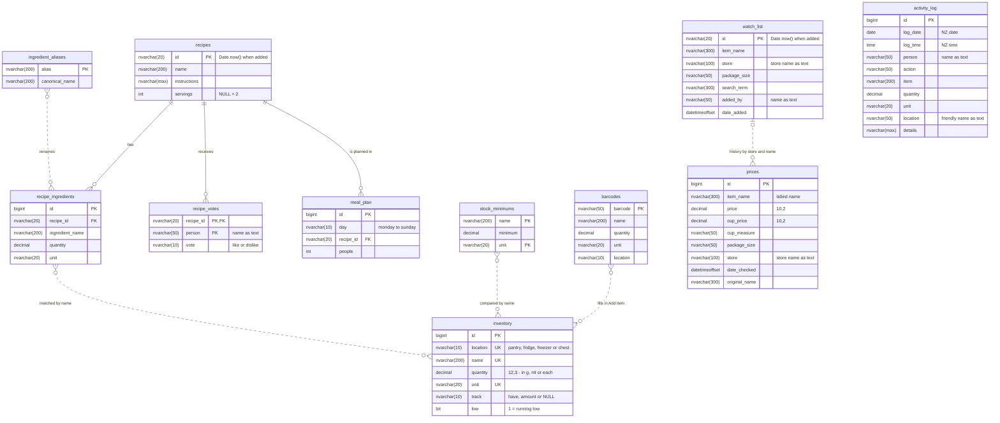
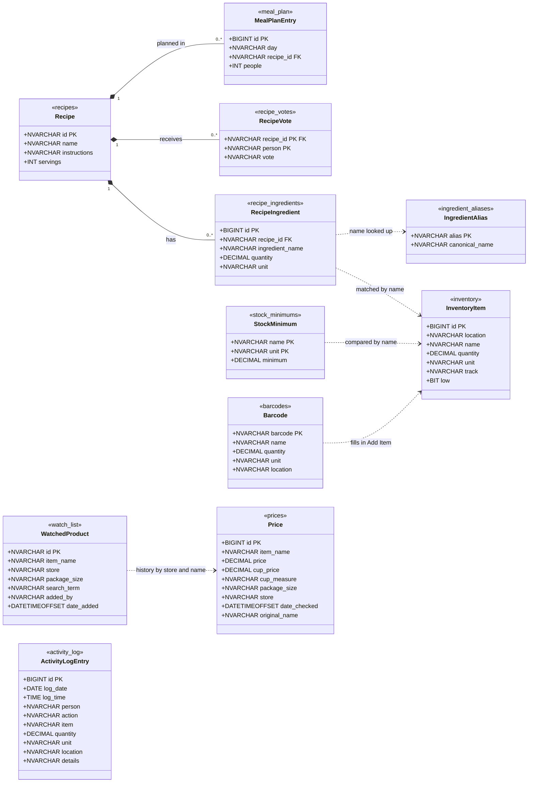
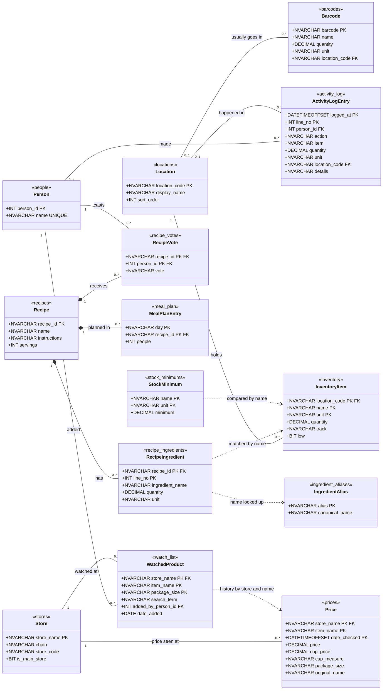

```mermaid
erDiagram
    people ||--o{ recipe_votes : "casts"
    people |o--o{ activity_log : "made"
    people ||--o{ watch_list : "added"
    stores ||--o{ prices : "price seen at"
    stores ||--o{ watch_list : "watched at"
    locations ||--o{ inventory : "holds"
    locations |o--o{ barcodes : "usually goes in"
    locations |o--o{ activity_log : "happened in"
    recipes ||--o{ recipe_ingredients : "has"
    recipes ||--o{ recipe_votes : "receives"
    recipes ||--o{ meal_plan : "is planned in"
    recipe_ingredients }o..o{ inventory : "matched by name"
    ingredient_aliases }o..o{ recipe_ingredients : "renames"
    stock_minimums }o..o{ inventory : "compared by name"
    watch_list |o..o{ prices : "history by store and name"

    people {
        int person_id PK "the only number id"
        nvarchar(50) name UK "Charlotte, Todd, Kayleigh"
    }
    stores {
        nvarchar(100) store_name PK "e.g. Woolworths Ferrymead"
        nvarchar(50) chain "Woolworths, PAKnSAVE or Trents"
        nvarchar(200) store_code "cookie or store ID the scraper uses"
        bit is_main_store "in the Our 3 stores search"
    }
    locations {
        nvarchar(10) location_code PK "pantry, fridge, freezer, chest"
        nvarchar(50) display_name "e.g. Freezer (Inside)"
        int sort_order
    }
    inventory {
        nvarchar(10) location_code PK, FK
        nvarchar(200) name PK
        nvarchar(20) unit PK "g, ml or each"
        decimal quantity "12,3"
        nvarchar(10) track "have, amount or NULL"
        bit low
    }
    recipes {
        nvarchar(20) recipe_id PK "unchanged text code"
        nvarchar(200) name
        nvarchar(max) instructions
        int servings
    }
    recipe_ingredients {
        nvarchar(20) recipe_id PK, FK
        int line_no PK "1, 2, 3 - order in the recipe"
        nvarchar(200) ingredient_name
        decimal quantity
        nvarchar(20) unit
    }
    recipe_votes {
        nvarchar(20) recipe_id PK, FK
        int person_id PK, FK
        nvarchar(10) vote
    }
    meal_plan {
        nvarchar(10) day PK "monday to sunday"
        nvarchar(20) recipe_id PK, FK
        int people
    }
    ingredient_aliases {
        nvarchar(200) alias PK
        nvarchar(200) canonical_name
    }
    prices {
        nvarchar(100) store_name PK, FK
        nvarchar(300) item_name PK
        datetimeoffset date_checked PK
        decimal price
        decimal cup_price
        nvarchar(50) cup_measure
        nvarchar(50) package_size
        nvarchar(300) original_name
    }
    activity_log {
        datetimeoffset logged_at PK "exact time of the change"
        int line_no PK "1, 2, 3 within one change"
        int person_id FK "NULL if nobody logged in"
        nvarchar(50) action
        nvarchar(200) item
        decimal quantity
        nvarchar(20) unit
        nvarchar(10) location_code FK "NULL for non-stock actions"
        nvarchar(max) details
    }
    stock_minimums {
        nvarchar(200) name PK
        nvarchar(20) unit PK
        decimal minimum
    }
    barcodes {
        nvarchar(50) barcode PK
        nvarchar(200) name
        decimal quantity
        nvarchar(20) unit
        nvarchar(10) location_code FK
    }
    watch_list {
        nvarchar(100) store_name PK, FK
        nvarchar(300) item_name PK
        nvarchar(50) package_size PK "blank if none"
        nvarchar(300) search_term
        int added_by_person_id FK
        date date_added
    }
```

# Database design

The household data lives in the Azure SQL database `pantry` on `charlotte-inventory2.database.windows.net`. This page documents the tables as they are now (phase 1) and the planned next version (phase 2), each as a crow's foot entity-relationship diagram and a UML class diagram.

GitHub draws the diagrams below automatically. The table definitions themselves are in [`database/create-tables.sql`](../database/create-tables.sql).

## Reading the diagrams

**Crow's foot (ER) diagrams**

| Symbol | Means |
|---|---|
| `||` | exactly one |
| `|o` | zero or one |
| `}o` | zero or many |
| `}|` | one or many |
| `solid line` | a real foreign key the database enforces |
| `dotted line` | matched by name in the code, no foreign key yet (the ingredients table fixes these) |

**UML class diagrams**

| Symbol | Means |
|---|---|
| `*--` | composition: the child rows belong to the recipe and are deleted with it (ON DELETE CASCADE) |
| `--` | association: a foreign key |
| `..>` | dependency: looked up by name in the code |
| `"1", "0..1", "0..*"` | multiplicity: exactly one, optional, any number |
| `<<recipes>>` | the SQL table behind the class |
| `PK / FK / UNIQUE` | primary key, foreign key, unique column |

## Phase 1: live now (since 11 October 2026)

Each table mirrors one of the old CSV files. Only recipes are linked by foreign keys. Everything else is matched by name in `server.js`.

### Crow's foot diagram

### UML class diagram

## Phase 2: proposed

Adds `people`, `stores` and `locations`, and links the other tables to them.

- Number ids are used only for people. Every other table is keyed by its real-world identity, using a composite key where one column is not enough.
- Foreign keys that point at a natural key (store_name, location_code) get ON UPDATE CASCADE, so renaming a store or storage area carries through to every row that uses it.
- Text keys compare without regard to capitals (the database collation is case-insensitive), the same way the site compares names.
- activity_log swaps its separate date and time columns for one exact logged_at time. The NZ date and time are worked out with AT TIME ZONE when reading.
- watch_list loses its Date.now() id, so the Price Checker page will remove a watched product by store, name and size instead.
- The CSV fallback is retired in phase 2. The old CSV files stay on the garage and in /root/csv-backup-2026-10-11 as an archive.

### Primary keys

| Table | Primary key | Why |
|---|---|---|
| `people` | `person_id (INT IDENTITY)` | The only number id. Renaming someone changes one row, and their votes, log lines and watched products follow. |
| `stores` | `store_name` | The name the scrapers, the store dropdown and the price history already use, e.g. Woolworths Ferrymead. |
| `locations` | `location_code` | Short fixed codes: pantry, fridge, freezer, chest. |
| `inventory` | `location_code + name + unit` | One row per thing, per place, per unit. The site already enforces this rule when it merges stock. |
| `recipes` | `recipe_id` | The existing text code (from Date.now() when added), so nothing the pages already know changes. |
| `recipe_ingredients` | `recipe_id + line_no` | Line 1, 2, 3 of the recipe. Keeps the ingredient order, and allows the same ingredient twice (salt in the sauce and in the marinade). |
| `recipe_votes` | `recipe_id + person_id` | One vote per person per recipe. |
| `meal_plan` | `day + recipe_id` | A recipe can be planned once per day. |
| `ingredient_aliases` | `alias` | Each alternative name points to one main name. |
| `prices` | `store_name + item_name + date_checked` | One price per product, per store, per moment. Full history, never updated. |
| `activity_log` | `logged_at + line_no` | The exact time of a change, plus line 1, 2, 3 for changes that log several rows at once (I made this). |
| `stock_minimums` | `name + unit` | One minimum per item and unit. |
| `barcodes` | `barcode` | The barcode number itself. |
| `watch_list` | `store_name + item_name + package_size` | The same rule the site already uses to stop the same product being starred twice. |

### Crow's foot diagram

### UML class diagram

## Later: the ingredients table

The next step after phase 2 is an ingredients table keyed by the ingredient name. ingredient_aliases, inventory, recipe_ingredients, stock_minimums and barcodes would then point at it with real foreign keys, and the dotted lines become solid.
